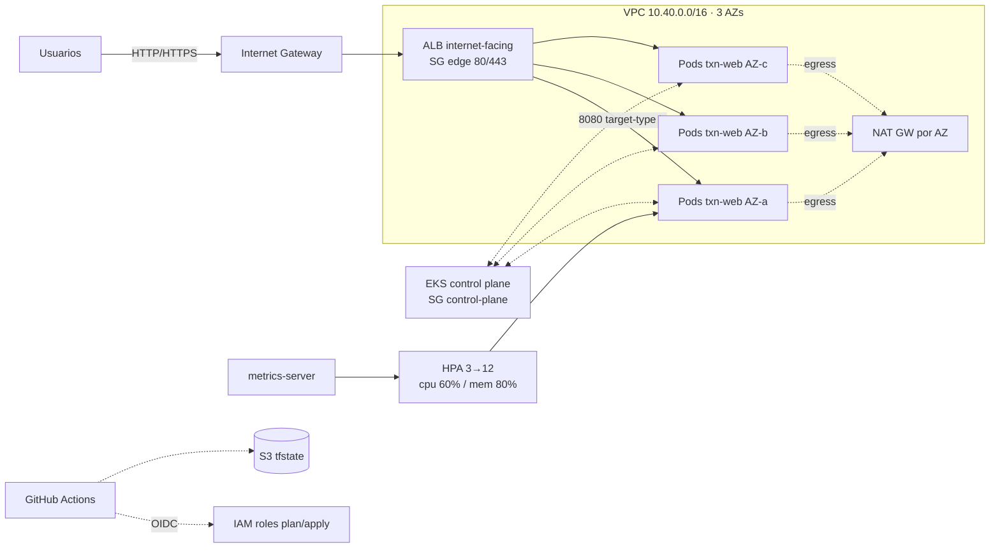

# ACME · Plataforma de transacciones en Amazon EKS (alta disponibilidad)

Solución al reto **Cloud Specialist · Caleidos**. Despliega con Terraform un cluster EKS multi-AZ que escala de forma horizontal y automática. Una app nginx se expone a través de un ALB. El pipeline de GitHub Actions sigue las bases técnicas *Terraform IaC* y *CI/CD & DevSecOps*.

> Criterio de diseño: **lo suficiente y necesario**. Cada pieza responde a un requisito del reto o a un control mínimo de esas bases. Lo que quedó fuera de alcance está listado al final, junto con la razón.

---

## 1. Arquitectura

Diagramas editables (se abren en [diagrams.net](https://app.diagrams.net) o con la extensión *Draw.io Integration* de VS Code):

| Diagrama | Nivel de detalle |
|---|---|
| [docs/architecture.drawio](docs/architecture.drawio) | General: VPC, AZs, subnets, NAT, ALB, EKS, servicios de soporte |
| [docs/architecture-cluster.drawio](docs/architecture-cluster.drawio) | Cluster: control plane, nodos por AZ, DaemonSets, pods y contenedores, objetos del namespace, flujo del HPA |
| [docs/security.drawio](docs/security.drawio) | Seguridad: OIDC GitHub → IAM, roles y trust, Access Entries, Pod Identity, KMS, auditoría, capas de red |
| [docs/delivery.drawio](docs/delivery.drawio) | Entrega continua: workflows `ci`, `terraform`, `app` y `destroy`, gates de aprobación, rollback |



| Capa | Implementación |
|---|---|
| Red | VPC /16 en 3 AZs. Subnets públicas /24 (solo ALB y NAT) y privadas /20 (nodos y pods). Un **NAT Gateway por AZ**, cada uno con su tabla de ruteo, para que una AZ caída no deje sin egreso a las demás. VPC Flow Logs. |
| Seguridad de red (por tier) | **edge** (ALB: 80/443 desde Internet y salida solo hacia nodes:8080) → **nodes** (8080 solo desde edge; tráfico entre nodos) ↔ **control-plane** (443 desde nodes). El SG por defecto queda sin reglas. En Kubernetes, NetworkPolicy *deny-all* más una regla que solo permite el puerto 8080 desde la VPC. |
| Cómputo | EKS 1.35 con **Managed Node Group** (3× t3.medium, uno por AZ; `max_size` 6 deja margen para escalar nodos a mano o con un autoscaler futuro). Launch Template con IMDSv2 (hop limit 1), EBS cifrado y acceso por SSM en lugar de SSH. |
| Acceso | EKS Access Entries (sin `aws-auth`). El AWS Load Balancer Controller usa **Pod Identity** y la app no tiene credenciales AWS. |
| Aplicación | `nginx-unprivileged` fijado por digest, non-root, root FS de solo lectura, PSS `restricted`, topology spread por AZ y PDB. |
| Exposición | Ingress, que el AWS Load Balancer Controller convierte en un ALB con `target-type: ip`: el ALB balancea **por request** directo a los pods. HTTPS opcional con ACM (componente `https`). |
| Autoscaling | HPA `autoscaling/v2` sobre CPU y memoria con `behavior` ajustado para la demo, alimentado por `metrics-server`, que es un add-on gestionado de EKS. |

## 2. Cómo cubre cada requisito del reto

| Requisito | Dónde |
|---|---|
| VPC con subnets públicas y privadas | [infra/modules/network](infra/modules/network) |
| NAT para el egreso de las subnets privadas | `aws_nat_gateway.this` (uno por AZ) en [network/main.tf](infra/modules/network/main.tf) |
| Security Groups por tier | [eks-cluster/security_groups.tf](infra/modules/eks-cluster/security_groups.tf) y [alb-ingress/main.tf](infra/modules/alb-ingress/main.tf) |
| Un cluster EKS + node groups | [infra/modules/eks-cluster](infra/modules/eks-cluster) |
| HPA | [k8s/base/hpa.yaml](k8s/base/hpa.yaml) + add-on `metrics-server` |
| App nginx expuesta por Service | [k8s/base](k8s/base) (Deployment, Service, Ingress → ALB) |
| Load balancer (HTTPS opcional) | [k8s/base/ingress.yaml](k8s/base/ingress.yaml) y [k8s/components/https](k8s/components/https) |
| Todo con Terraform | [infra/](infra), incluido el controlador de ALB vía Helm |
| Pipeline (opcional) | [.github/workflows](.github/workflows) |
| Diagrama | [docs/architecture.drawio](docs/architecture.drawio) + detalle de [cluster](docs/architecture-cluster.drawio), [seguridad](docs/security.drawio) y [entrega](docs/delivery.drawio) |
| Decisiones de arquitectura (ADR) | [docs/adr](docs/adr/README.md) |
| Manifests YAML | [k8s/](k8s) |
| Demo de balanceo y HPA | [scripts/demo-balancing.sh](scripts/demo-balancing.sh) y [scripts/demo-hpa.sh](scripts/demo-hpa.sh) |

## 3. Estructura

```
infra/
  modules/                      # mecanismos reutilizables, sin valores de entorno
    network/                    # VPC, subnets, NAT por AZ, rutas, flow logs (+ tests)
    eks-cluster/                # control plane, MNG, SGs, access entries, add-ons
    alb-ingress/                # SG edge + AWS Load Balancer Controller (Pod Identity)
  live/                         # composición por entorno (decisiones del producto)
    bootstrap/                  # state S3 + OIDC GitHub + roles plan/apply (una vez)
    dev/us-east-1/platform/     # stack: network + eks + alb-ingress
k8s/
  base/                         # Deployment, Service, Ingress, HPA, PDB, NetworkPolicy
  components/stress-sidecar/    # sidecar stress-ng (solo entornos no productivos)
  components/https/             # listener 443 + redirect + TLS 1.3 (ACM)
  overlays/dev/                 # composición del entorno
.github/
  workflows/                    # ci, terraform, app, destroy
scripts/                        # deploy, demos, destroy ordenado
docs/                           # diagramas draw.io (general, cluster, seguridad, entrega) + ADRs
```

Cada módulo tiene README, variables validadas y outputs mínimos. Los stacks no copian lógica: solo componen módulos. En una organización real, `modules/` viviría en un repositorio de plataforma versionado (tag inmutable), y este repo lo consumiría por `?ref=vX.Y.Z`.

## 4. Despliegue

### Prerrequisitos

- Cuenta AWS con permisos de administrador (solo para el bootstrap).
- Terraform ≥ 1.10 (validado con 1.13), AWS CLI v2 y kubectl.
- Bash: en Windows, Git Bash.
- Costo aproximado: **~USD 0.40/hora** (EKS, 3 NAT, 3 t3.medium, ALB, IPs públicas). Al terminar, ver [Destrucción](#7-destrucción).

### Opción A: comandos manuales

```bash
# 1) Fundaciones: bucket de state + roles OIDC para el pipeline (state local, una sola vez)
cd infra/live/bootstrap
cp terraform.tfvars.example terraform.tfvars   # editar github_repository
terraform init && terraform apply
terraform output                               # state_bucket, plan_role_arn, apply_role_arn

# 2) Plataforma (~15-20 min)
cd ../dev/us-east-1/platform
cp backend.hcl.example backend.hcl              # poner el bucket del paso 1
terraform init -backend-config=backend.hcl
terraform plan -out=tfplan
terraform apply tfplan

# 3) Aplicación (desde la raíz del repo)
bash scripts/deploy-app.sh                     # kubeconfig + apply -k + rollout + smoke test
```

> Si aplicas la plataforma desde tu laptop y luego usarás el pipeline, copia `local.auto.tfvars.example` a `local.auto.tfvars` (ignorado por git) con el rol de apply como admin y el de plan como viewer, y define en GitHub la variable `EKS_ADMIN_PRINCIPAL_ARNS` = `["<apply_role_arn>"]`. Así ambos podrán operar el cluster. EKS solo da admin automático al creador.

### Opción B: pipeline (GitHub Actions)

1. Ejecutar el bootstrap (paso 1 de la opción A).
2. En GitHub → *Settings → Secrets and variables → Actions → Variables*, crear:
   `AWS_REGION=us-east-1`, `TF_STATE_BUCKET`, `AWS_PLAN_ROLE_ARN` y `AWS_APPLY_ROLE_ARN`.
3. Crear el Environment **`dev`** (*Settings → Environments*) con *Required reviewers*. Ese es el gate de aprobación antes de `apply` y del deploy.
4. Hacer push a `main` con cambios en `infra/` (o *Actions → terraform → Run workflow*). Revisar el plan en el resumen del run y aprobar el job `apply`. Al terminar, el workflow `app` despliega la aplicación.

## 5. Demostración

```bash
aws eks update-kubeconfig --name acme-txn-dev --region us-east-1
```

### 5.1 Balanceo de tráfico entre pods y AZs

```bash
bash scripts/demo-balancing.sh 60
```

El script lanza 60 requests a `/whoami` a través del ALB e imprime cuántas respondió cada Pod, junto con su AZ. Ejemplo de salida:

```
  txn-web-7c9d…-4xk2p (us-east-1a)    21
  txn-web-7c9d…-9hj7d (us-east-1b)    19
  txn-web-7c9d…-qm5tz (us-east-1c)    20
```

En el navegador, `http://<alb-hostname>` muestra la página de nginx con el **nombre del Pod, su IP y el nodo**. Se refresca cada 2 s y el Pod va cambiando. Cada respuesta incluye además el header `X-Served-By`.

### 5.2 Escalamiento automático (HPA) con stress-ng

```bash
# Terminal 1: observar (kubectl -w acepta un solo tipo de recurso)
kubectl -n acme-txn get hpa txn-web -w
# Terminal 1b (opcional): kubectl -n acme-txn get pods -o wide -w

# Terminal 2: generar carga dentro de los pods (sidecar "stress")
bash scripts/demo-hpa.sh cpu 240        # o: memory 240
```

Qué ocurre:

1. `stress-ng` consume CPU (hasta 500m) o memoria (256 MiB) en cada Pod existente.
2. `metrics-server` reporta un uso muy por encima del target (60% CPU / 80% memoria sobre los *requests*).
3. El HPA escala de **3 hasta 12 réplicas**, con hasta +100% o +4 pods cada 30 s. Las réplicas nuevas se reparten entre AZs.
4. Al terminar la carga, y tras una ventana de estabilización de 120 s, el HPA reduce las réplicas de vuelta a 3.

Para ver el razonamiento del HPA: `kubectl -n acme-txn describe hpa txn-web`.

> Por qué un sidecar: la imagen nginx no incluye `stress-ng`. El componente de Kustomize `stress-sidecar` lo agrega **solo en dev**, sin tocar la imagen ni la base. Sus `requests` suman a los del Pod, que es justo lo que evalúa el HPA (`type: Resource`).

### 5.3 HTTPS (opcional)

Requiere un dominio y un certificado ACM emitido para él:

1. Reemplazar `txn.example.com` en [k8s/components/https/kustomization.yaml](k8s/components/https/kustomization.yaml).
2. Descomentar `- ../../components/https` en el overlay `dev`.
3. Crear un CNAME del dominio hacia el hostname del ALB.

El controlador descubre el certificado por hostname. El puerto 80 redirige a 443 y la política es TLS 1.3/1.2.

## 6. Pipeline CI/CD y DevSecOps

Cuatro workflows pequeños e independientes:

| Workflow | Disparador | Qué hace |
|---|---|---|
| [ci.yml](.github/workflows/ci.yml) | Pull Request a `main` | Terraform (fmt · validate · test · tflint · Checkov), Kubernetes (kustomize · kubeconform · Checkov) y gitleaks. No toca AWS. |
| [terraform.yml](.github/workflows/terraform.yml) | Push a `main` en `infra/**` o manual | `plan` (rol read-only, plan en el resumen del run) → **aprobación manual** (Environment `dev`) → `apply` del plan exacto |
| [app.yml](.github/workflows/app.yml) | Push a `main` en `k8s/**`, tras `terraform` exitoso o manual | `kubectl apply -k` → rollout → smoke test vía ALB → `rollout undo` si falla |
| [destroy.yml](.github/workflows/destroy.yml) | Manual, con confirmación | App primero, luego `terraform destroy` |

```
push main (infra/**) ─► plan ─► [aprobar en GitHub] ─► apply ─► app: deploy ─► smoke ─► (rollback si falla)
```

| Principio de las bases | Aplicación |
|---|---|
| Solo se ejecuta lo afectado | Filtros `paths` por workflow: `infra/**` dispara Terraform, `k8s/**` dispara el deploy de la app |
| Identidad federada y permisos mínimos | OIDC sin access keys. Rol **plan** read-only y rol **apply** limitado por `sub` al Environment protegido. `permissions` mínimos. |
| Supply chain | Actions fijadas por **SHA**, binarios con **checksum verificado**, imágenes por **digest**, `.terraform.lock.hcl` multi-plataforma versionado y provider/chart con versión fija |
| Plan revisado → apply exacto | El plan se guarda como artefacto efímero (1 día) y el apply usa ese archivo. Si el state cambió, Terraform rechaza el plan. |
| Gates de seguridad | Checkov falla con cualquier hallazgo. Las excepciones se declaran inline con su razón (`#checkov:skip=ID:razón`) y quedan auditadas en el PR. |
| Verify y rollback | `rollout status` y smoke `/whoami` contra el ALB. Si fallan, `rollout undo`. |

### Validación ejecutada localmente

| Chequeo | Resultado |
|---|---|
| `terraform fmt` / `validate` (3 módulos + 2 stacks) | OK |
| `terraform test` (módulo network, mock provider) | 5/5 pass |
| `tflint` (preset recommended + ruleset AWS 0.49.0) | sin hallazgos |
| Checkov Terraform | 146 pass · 0 fail · 16 excepciones justificadas |
| Checkov Kubernetes (overlay dev renderizado) | 92 pass · 0 fail · 3 excepciones justificadas |

## 7. Destrucción

```bash
bash scripts/destroy.sh
```

El script **borra primero el Ingress**, para que el controlador elimine el ALB y sus target groups, y después ejecuta `terraform destroy`. Si se invierte el orden, el ALB queda huérfano y bloquea el borrado de la VPC. También existe el workflow manual `destroy`. El bucket de state tiene `prevent_destroy`.

## 8. Decisiones y trade-offs

| Decisión | Motivo |
|---|---|
| Módulos propios en lugar de `terraform-aws-modules/eks` | Para mostrar contratos pequeños y explícitos (base IaC §4). En producción, un módulo comunitario fijado por versión también es válido. |
| Endpoint público del API server | Lo necesitan los runners hospedados de GitHub y la demo. Se puede acotar con `eks_public_access_cidrs`. La alternativa es usar runners self-hosted dentro de la VPC y un endpoint privado. |
| Rol `apply` con `AdministratorAccess` | Excepción explícita del reto (con owner y fecha de revisión en el código). Su `sub` solo admite el Environment protegido. En producción se reemplaza por una política acotada + permissions boundary. |
| ALB por Ingress (LBC) en lugar de `Service type: LoadBalancer` | Balanceo L7 por request a los pods (ideal para la demo), health checks HTTP, HTTPS/TLS 1.3 y SG del ALB controlado por Terraform. |
| Reglas de backend del ALB en Terraform (`manage-backend-security-group-rules: false`) | El flujo edge → nodes queda declarado, revisado y escaneado como código. |
| 3 NAT Gateways | HA del egreso por AZ, como pide el reto. Para entornos efímeros, `single_nat_gateway = true` ahorra ~USD 65/mes. |
| `minReplicas: 3` | Al menos una réplica por AZ. |

### Fuera de alcance (siguientes pasos)

- Autoscaling de **nodos** (Karpenter o Cluster Autoscaler). El HPA escala pods y el node group tiene margen para 12 réplicas.
- WAF, Route 53 y certificado ACM gestionados por Terraform. Requieren un dominio propio.
- Observabilidad completa: dashboards, alarmas con runbook, SLOs y Container Insights.
- Entornos staging/prod: se agregan como nuevos `live/<env>` y `overlays/<env>` sin cambiar módulos.
- GitOps (Argo CD / Flux) en lugar de `kubectl apply` desde CI.
- DAST (OWASP ZAP) contra dev y firma/SBOM de imágenes propias (aquí la imagen es pública).
